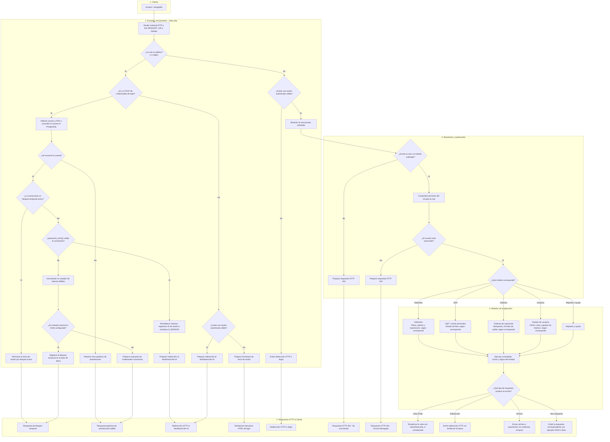

# Arquitectura y macroflujo de RTP-Preventivo

**Tecnología indicada:** PHP 8.2, PostgreSQL mediante PDO y arquitectura MVC ligera.

**Propósito:** representar el recorrido general de una solicitud desde su entrada al sistema hasta la respuesta HTTP, incluyendo autenticación, autorización por roles (RBAC), ejecución de módulos y respuestas finales. El orden exacto de los pasos debe coincidir con la implementación real.

## 1. Macrodiagrama general

## 2. Notas técnicas y puntos de verificación

- **Enrutamiento:** confirmar que `index.php` recibe las solicitudes y clasifica las rutas públicas y privadas como se muestra.
- **PDO:** comprobar cuándo se carga `config/database.php` y cuándo se establece la conexión. El diagrama no presupone que toda solicitud abra una conexión si el código no lo hace.
- **Autenticación:** validar el orden real de búsqueda de la cuenta, comprobación del bloqueo, uso de `password_verify()` y actualización de los intentos.
- **Cuenta inexistente:** esta versión separa la cuenta no encontrada de los fallos de contraseña y no la pasa por el contador, siguiendo la descripción proporcionada por la auditoría de Gemini. Confirmar que el código haga exactamente eso.
- **Contador y bloqueo:** el flujo supone que se incrementa el contador después de una contraseña incorrecta y luego se evalúa el límite. Confirmar el orden, el umbral y la duración del bloqueo en la implementación; esos valores no se fijan en este documento.
- **Sesiones:** comprobar que `session_regenerate_id()` y la inicialización de `$_SESSION` ocurran después de autenticar correctamente.
- **Autorización:** verificar si la aplicación comprueba primero la existencia de la ruta y luego los permisos, como se dibuja, y si protege también las operaciones sensibles dentro de cada módulo.
- **Respuestas terminales:** comprobar que los flujos 403 y 404 realmente detengan la ejecución y no continúen hacia los módulos.
- **MVC y layout:** confirmar que el controlador ejecuta la lógica antes de renderizar `views/base.php`, y que las redirecciones y salidas de archivos omiten el layout.
- **Rutas públicas con sesión:** verificar que una sesión válida al visitar `/` o `/login` provoca una redirección al dashboard del rol.
- **Consideración de seguridad:** si la respuesta por cuenta bloqueada es distinta de la respuesta por credenciales incorrectas, evaluar si esa diferencia puede revelar la existencia de una cuenta. La decisión debe documentarse según el comportamiento y los requisitos reales.

## 3. Alcance y criterio de aceptación

Este es un macrodiagrama, no un diagrama de clases ni una auditoría completa de seguridad. Debe considerarse definitivo solo después de contrastar las ramas, nombres, condiciones y respuestas con el código fuente. Las recomendaciones que no estén implementadas deben mantenerse como observaciones y no presentarse como controles existentes.
